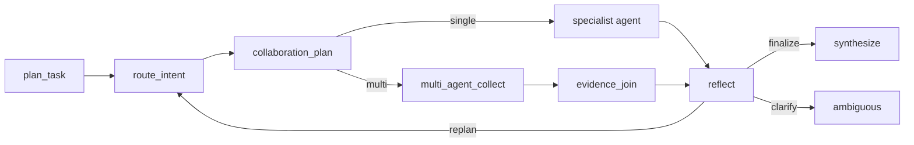

# Multi-Agent Evidence Join Design

## Goal

Upgrade the LangGraph chain from single-specialist execution to optional multi-agent collaboration for complex read/analysis questions. The graph should collect evidence from several warehouse agents, join it into one evidence bundle, and then send that bundle through the existing Reflection + LLM Judge node before final answer synthesis.

## Design

New graph shape:

`collaboration_plan` decides whether a request is safe and useful for multi-agent collaboration. It only enables multi-agent collection when:

- the request is read/analysis oriented;
- the plan risk is not high;
- the request does not contain detected write actions;
- the question looks cross-domain, diagnostic, analytical, or optimization-oriented.

High-risk write actions such as creating waves, dispatching forklifts, and adjusting inventory stay on the existing single-agent + approval path.

## Agent selection

Default selected agents are capped at four. The primary route is always included. Complex warehouse diagnostics can add:

- `operations`: order/task/worker/wave evidence
- `equipment`: forklift, AGV, conveyor, scanner, inventory/equipment evidence
- `safety`: incident, alarm, blocked zone, safety event evidence
- `forecasting`: demand, trend, replenishment, capacity pressure evidence
- `document`: SOP/manual/report evidence, only when document keywords exist

## Evidence bundle

`evidence_join` produces:

- `contributing_agents`
- `evidence_items`
- `average_confidence`
- `coverage`
- `gaps`
- `summary`

The bundle is stored in `context["evidence_bundle"]`, `context["autonomous_reasoning"]["evidence_bundle"]`, and `agent_responses["evidence_join"]`.

## Observability

Run Center should show:

- multi-agent selected
- selected agents
- evidence joined
- evidence count
- evidence gaps

## Non-goals

- No high-risk write execution in multi-agent mode.
- No new model provider.
- No runtime verification in this pass.
