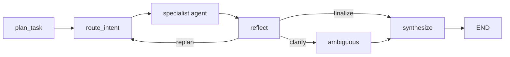

# Planner + Reflection Loop Design

## Goal

Add a visible LangGraph planning and reflection loop to the MCP warehouse assistant so the product can demonstrate more than one-shot routing: it should plan, route, execute, reflect, then either finalize, ask for missing information, or replan once more.

## Scope

This change targets the MCP integrated planner graph used by chat requests. It does not replace existing approval interrupts, checkpointer persistence, or specialist agents. It wraps the existing flow with two new graph concepts:

- `plan_task`: creates a structured task plan, risk profile, required facts, and route hint before routing.
- `reflect`: reviews the selected agent result before final response synthesis.

## Non-goals

- No new external model provider.
- No browser/runtime verification in this pass.
- No real WMS/ERP side effects.
- No broad rewrite of specialist agents.

## Behavior

The new graph shape is:

Reflection has a bounded loop. Default maximum reflection iterations is `2`, configurable through request context with `max_reflection_iterations`.

## Reflection decisions

The reflection engine can produce:

- `finalize`: current result is safe enough to synthesize.
- `clarify`: request is missing critical facts, especially before high-risk write actions such as creating waves, dispatching forklifts, or adjusting inventory.
- `replan`: route appears weak, result is missing/low-confidence, or the original route conflicts with the plan hint.

## State and observability

The graph state and response context should include:

- `planner_scratchpad`
- `reflection_decision`
- `reflection_history`
- `reflection_iterations`
- `max_reflection_iterations`

Run Center timeline should receive explicit events for plan creation and reflection results, so users can see the agent’s “思考/反思” process.

## Safety

Reflection does not execute write operations by itself. Approval interrupt remains the authority for high-risk tool execution. Reflection only prevents weak final answers by asking clarifying questions or rerouting before final synthesis.

## Testing posture

Add unit-test examples for the pure reflection planner functions. Per the user’s current instruction, do not run validation commands in this pass.
